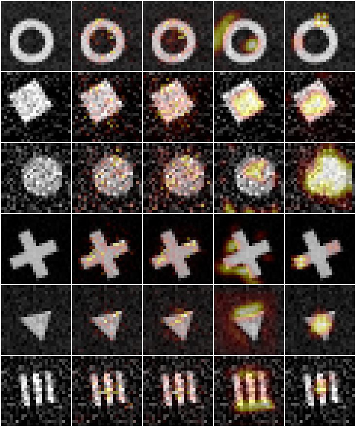

# cnn-explain

A small CNN in NumPy with hand-written backprop (every layer gradient-checked), trained on procedurally generated shapes, and then poked at: saliency maps, attacks, robustness, and certified bounds.



*Columns: input, saliency, SmoothGrad, Grad-CAM, occlusion. One row per class.*

```bash
cd cnn-explain
pip install -r requirements.txt
export PYTHONPATH=src
python -m cnn_explain train --epochs 12 --out model.npz     # ~10 s, 38,566 params
python -m cnn_explain explain --model model.npz --faithfulness 150
python -m cnn_explain robust --model model.npz
python -m cnn_explain train --ibp-eps 0.03 --epochs 16 --out cert.npz
python -m cnn_explain certify --model cert.npz --eps 0.01 0.02 0.03 0.05
python -m pytest -q                                          # 66 tests
```

## Results

The base model gets 97.3% on 1,000 test images. Most mistakes are disk vs square.

**Which explanation is faithful?** I blanked the top-ranked pixels from each map and watched the class probability drop (lower AUC is better): occlusion 0.280, SmoothGrad 0.345, saliency 0.373, Grad-CAM 0.588, random 0.691. Occlusion is favoured by how the metric works. Grad-CAM looks the nicest but is only 12x12, so it ranks individual pixels badly.

**It's brittle.** 90% with pixel noise 0.2, but 79% when shifted 2 px and 37% at 4 px. FGSM at eps 0.05 takes it to 36%.

**Adversarial training** roughly doubles robustness at and below the training eps (FGSM 0.05: 0.33 to 0.72) with no clean-accuracy cost, but it didn't help with noise or shifts and made contrast worse.

**Global-average-pool head:** swapping the dense head for GAP + BatchNorm (width 16) drops only 5 points at a 4 px shift where the dense head drops 62, with fewer parameters. The catch is contrast: it keeps 0.656 at half contrast vs 0.902. Training with contrast augmentation fixes that specific perturbation and makes a slightly different one (contrast around the mean) worse than chance. It learned "dim means shrink", not contrast invariance.

**Certified robustness (interval bound propagation):**

| model | clean | certified at eps 0.03 | PGD at 0.03 |
|---|---|---|---|
| standard | 0.988 | 0.000 | 0.479 |
| FGSM-trained | 0.982 | 0.000 | 0.859 |
| IBP-trained | 0.839 | 0.561 | 0.718 |

Normally trained nets can't be certified at all, even when they resist attacks. Training through the bounds proves 56% of images safe, but costs about 15 points of clean accuracy.

## Caveats

Procedural shapes, so none of this transfers directly to natural images. Three seeds for the experiments. The deletion metric fills with background, which is itself off-distribution. Only the certify numbers are proofs, and only for L-inf perturbations. The IBP recipe got a small sweep on a different test seed.
