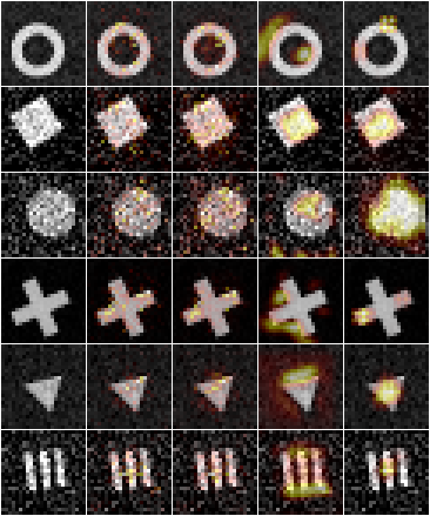

# visionlab

A convolutional neural network, its trainer, three attribution methods and two adversarial attacks, all in **pure NumPy** with hand-written backpropagation. No PyTorch, no autograd: every layer's backward pass is checked against finite differences.



*Columns: input · saliency · SmoothGrad · Grad-CAM · occlusion. Rows: one image per class (ring, square, disk, cross, triangle, stripes).*

## What's in it

| Module | What it does |
|---|---|
| `layers.py` | `Conv2D` (im2col via strided window view + one matmul), `MaxPool2D` (one-argmax gradient routing), `Dense`, `ReLU`, inverted `Dropout`, `Flatten`, fixed `Normalize` |
| `model.py` | `Sequential` that records every layer's activation and output-gradient (used by Grad-CAM), softmax CE with label smoothing, `.npz` save/load with the architecture embedded |
| `optim.py` | SGD + momentum, AdamW-style decoupled weight decay |
| `data.py` | Procedural, anti-aliased, seeded dataset: disk, ring, square, triangle, cross, stripes at random size/position/rotation/brightness/noise |
| `train.py` | Mini-batch trainer: cosine LR, flip/rot90 augmentation, optional FGSM adversarial training |
| `explain.py` | Saliency, SmoothGrad, Grad-CAM, occlusion, plus a **deletion-curve faithfulness metric** to compare them |
| `attacks.py` | FGSM and PGD (random start, L-inf ball) in raw pixel space |
| `robust.py` | Accuracy under noise / translation / contrast loss and under attack |
| `png.py` | Dependency-free PNG writer and heat-map montage |

## Quick start

```bash
pip install -r requirements.txt
export PYTHONPATH=src
python -m visionlab train --epochs 12 --out model.npz      # ~10 s on a laptop CPU, 38,566 parameters
python -m visionlab eval --model model.npz                  # accuracy + Wilson CI + confusion matrix
python -m visionlab explain --model model.npz --faithfulness 150
python -m visionlab robust --model model.npz
python -m visionlab show --model model.npz -n 2             # ASCII-art predictions
python -m pytest -q                                         # 41 tests, ~10 s
```

## Results (all on synthetic shapes, test set disjoint from training)

**Accuracy.** 12 epochs, 4,000 training images: **97.3 %** on 1,000 test images (95 % Wilson CI 96.1-98.1 %). The errors are mostly disk <-> square (15 of 27) and square <-> triangle (9).

**Which explanation can you trust?** Deletion AUC = mean class probability while the top 0-40 % of pixels ranked by each map are blanked (lower means the map found what the model actually uses). 147 correctly classified images:

| Method | Deletion AUC |
|---|---|
| occlusion | **0.280** |
| SmoothGrad | 0.345 |
| plain saliency | 0.373 |
| Grad-CAM | 0.588 |
| random ranking | 0.691 |

Occlusion wins because it measures the effect of removing pixels directly, which is also what the metric does, so it is favoured by construction. Grad-CAM's maps are visually the most plausible (see image) but only 12x12 resolution, so they rank individual pixels poorly. All four beat random.

**Brittleness.** On the same model: 90 % accuracy at pixel noise sigma 0.2, but only 79 % when the image is translated by 2 px diagonally and 37 % at 4 px. The dense head is not translation invariant and training never shows shifted images beyond the dataset's own jitter. Gradient attacks are far more damaging than noise: FGSM at eps = 0.05 (about 13/255) cuts accuracy to 36 %, 10-step PGD to 26 %.

**Adversarial training** (`experiments/adv_training.py`, mean of 3 seeds, FGSM eps = 0.05 mixed 1:1 into every batch; attacks on 400 test images):

| | clean | FGSM 0.02 | FGSM 0.05 | FGSM 0.1 | PGD 0.05 | PGD 0.1 |
|---|---|---|---|---|---|---|
| standard | 0.986 | 0.689 | 0.327 | 0.128 | 0.186 | 0.031 |
| adversarially trained | 0.982 | 0.892 | 0.723 | 0.483 | 0.652 | 0.265 |

Clean accuracy is unchanged within seed noise (+-0.01); robustness at and below the training budget roughly doubles. Noise/shift robustness did not improve (noise 0.3: 0.757 vs 0.750; shift 2 px: 0.795 vs 0.805), and contrast-0.5 accuracy dropped (0.910 -> 0.865). Robustness does not transfer across perturbation types, and eps = 0.1 stays largely broken. Only 3 seeds, so differences of ~0.01-0.02 are noise.

## How it is tested

- Gradient checks (float64 finite differences) for `Conv2D` at several paddings/kernel sizes, `Dense`, `ReLU`, `MaxPool2D` (even and odd sizes), `Normalize`, the cross-entropy + label-smoothing gradient, the whole network w.r.t. every parameter *and* its input, and the loss gradient used by the attacks.
- `Conv2D` equals a naive 4-loop convolution; max-pool ties send the gradient to exactly one pixel.
- Saliency equals the finite-difference logit gradient; Grad-CAM uses the right layer and is class-specific; occlusion of blank background is zero; the deletion curve starts at the clean probability and an informative map beats a random one.
- FGSM/PGD stay inside the eps ball and the valid pixel range and raise the loss; adversarial training improves FGSM accuracy; optimisers converge on a quadratic.
- Dataset determinism, class balance, label-preserving augmentation, PNG round trip, save/load round trip.

## Limits

- The data is procedural and the classes are easy for humans; numbers do not transfer to natural images.
- The deletion metric replaces pixels with 0 (background), which is itself off-distribution for the network; treat the ranking as indicative, not definitive.
- Single train/test split per CLI run; the experiment uses 3 seeds.
- FGSM-trained models are known to be partly "gradient masked"; PGD above is a stronger check, but this is not a certified robustness claim.
